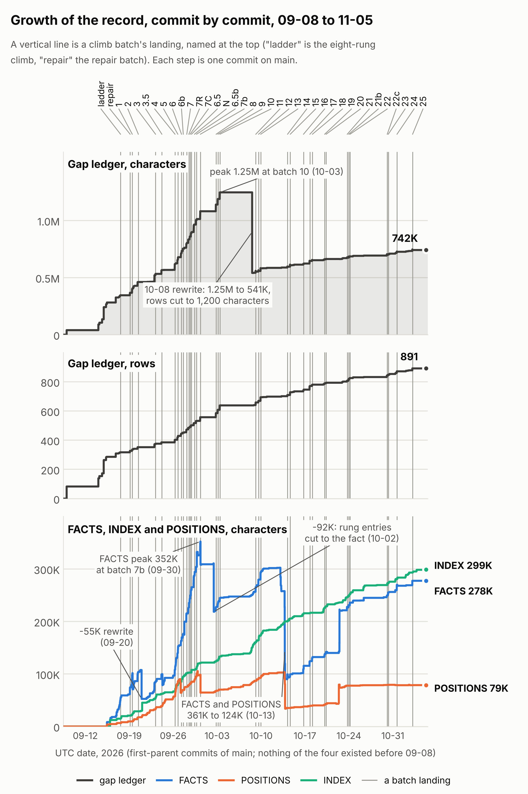

# Fortress: the revival so far

## Glossary

The words below have one meaning on this page. Skim them if a term is new to you.

- **batch**: Set of tasks that agents carry out at once and land together.
- **checker**: Compiler's static type checker.
- **checker count**: Checker's errors on `FortressLibrary`, up to the first stage with an error.
- **closed trait**: Trait with a `comprises` clause.
- **code generator**: Part of the compiler that writes bytecode.
- **coercion**: Declared conversion from one type into another.
- **compiler**: Team's implementation that compiles to JVM bytecode.
- **component**: File of Fortress code that implements apis.
- **core**: Components of the library that every program loads.
- **curator**: Person in charge of the revival.
- **dispatch**: Run-time choice among overloads.
- **distance**: Checker's errors on the core, with every stage run.
- **exclude**: Relation of two types that no value has together.
- **functional method**: Method with `self` among its parameters, called as `f(x)`.
- **gap**: Something missing or broken.
- **gap ledger**: File with one numbered row for each known gap.
- **gate**: Full build and test of a batch before it lands.
- **instantiation rule**: Rule that no type extends two instantiations of one generic trait.
- **interpreter**: Team's implementation that runs programs without static types.
- **library**: Interpreter's library.
- **microGPT**: Karpathy's small GPT, in two Fortress programs.
- **native binding**: Library function whose body is Java code.
- **phase**: One of the six parts of the curator's plan.
- **quick check**: Short run of microGPT under the interpreter.
- **reading**: One of several interpretations of a rule.
- **record**: Project's notes.
- **reduction**: Library object that combines the values of a big operator.
- **self-typed trait**: Trait whose parameter stands for its implementing type.
- **siblings**: Number types of which none is a subtype of another.
- **stage**: One kind of check in the checker's sequence.
- **static parameter**: Type or size parameter of a declaration.
- **switch-over**: Step at which the compiler starts to use the library.
- **tower**: Number types in which each is a subtype of the next.
- **type group**: Part of the team that built the checker and the compiler.
- **Working Draft**: Team's last full specification, of 2 February 2011.

## 1. Fortress, the revival and who does the work

Fortress was an experimental language for high-performance computing. A team at Sun Labs designed and built it from 2003 to 2012, led by Guy L. Steele Jr. and Eric Allen. Sukyoung Ryu, David Chase, Jan-Willem Maessen and Christine Flood were at its core. On this page, "the team" means that group. The [repository's README](https://github.com/palimondo/fortress) tells its history.

The team's lab, by then Oracle Labs, ended the project in summer 2012. Its hardest problem was still open: instantiating generic code at run time at a low cost. The team left a specification with features that it never built, an interpreter, and a partial compiler to JVM bytecode. By 2026 that code no longer built on current Java.

The revival began on 18 August 2026. It finishes the team's design and doesn't redesign it. Its aim is one model, Andrej Karpathy's microGPT, a small GPT in Python. The revival wants it compiled from Fortress to JVM bytecode, and as fast as a version written in plain Java.

In Fortress, microGPT is two programs. The flat program holds the model's data in flat, unnested arrays, after Aaron Hsu's style of APL. The APL program is written in an APL notation, which a grammar that the program imports turns into Fortress code.

AI agents do the work: sessions of Anthropic's Claude, each started with written instructions for one task. They write the code, the tests and the project's notes, and one of them coordinates the others. The curator, the person in charge of the revival, directs them. He sets the goals and their order, decides what the team's sources leave open, and approves each step of the work before it starts.

## 2. The rule and the team's sources

### The rule

One rule judges every change, the revival's first: "We are custodians of their language, not its authors." The revival finishes what the team intended. It adds a design of its own only where the team's sources leave a question open, and then the curator decides it. Four practices follow from the rule:

- The revival changes the team's Fortress for one of two reasons only: two of the team's sources contradict each other, or a program fails.
- Where two sources contradict each other, the team's later choice wins (below).
- An agent checks every claim against the team's sources or a command's output.
- No committed file claims credit for the revival. Where git doesn't record who wrote something, an agent works it out from the history and never guesses.

### The team's three sources

- **The specification.** The team published version 1.0 in March 2008, and its last full text is the Working Draft of 2 February 2011. The repository keeps that text unchanged, beside a copy that agents revise.
- **The type papers.** The type group, the part of the team that built the type checker and the compiler, wrote them. The chief ones are the OOPSLA 2011 paper of Allen and others, Karl Naden's notes of 2012, and the POPL 2019 paper of Park, Hong, Steele and Ryu.
- **The code.** It holds two implementations, each with its own library. The interpreter, run by `fortress walk`, runs a program without static types. The compiler, run by `fortress compile`, checks a program's types with its type checker, here called the checker, and writes JVM bytecode. From here on, "the library" alone means the interpreter's library.

### How a contradiction is decided

The team's later choice wins over its earlier one, in a text or in code. Code counts as a choice where the team built it the same way for all its types. It also counts where the team stated its rule in a commit message, a comment or the checker. Code that its author called a stub, or that works around a limit of the JVM, doesn't count.

Much of the Working Draft came before the implementations. The type group later learned what could be built and made fast, and put that into the type papers and the compiler's library. So the revival follows those where they depart from the Working Draft. Where two later choices conflict, or the sources settle nothing, the curator decides by the revival's aim: microGPT compiled and fast.

An agent marks each changed passage of the specification with a box headed "Revised by the 2026 revival", as the team marked its own changes. The box points to an entry in Appendix I, which gives the change, its reason and the original text.

## 3. How the work runs

### Components and the plan

Fortress code comes in components. A component is a file of code that implements apis, its interfaces, and imports the apis that it uses. The library's core is the components that a program imports by default, and the components that those import. Every program that the interpreter runs loads the core, and so will every compiled program once the compiler uses the library.

On 26 September the curator approved a plan of six phases. Phases 1 and 2 carried out work that he had already decided. The other four:

3. The checker reports no error on the library's core.
4. The switch-over, the step at which the compiler starts to use the library and its own library is deleted, and the work it needs first.
5. microGPT compiles. This needs its static types, the design of its arrays, and the end of the code generator's gaps. The code generator is the part of the compiler that writes bytecode, and a gap is something missing or broken. Phase 5 also takes on the team's open problem: the compiler will instantiate generic code at run time by the POPL 2019 paper's rule.
6. microGPT runs fast, with unboxed numbers, measured against the plain Java version.

A native binding, the subject of much of phase 4, is a library function whose body is Java code.

### A batch

The agents work in batches. A batch is a set of tasks that agents carry out at the same time and land together. To land is to commit to `main` and push it.

Batches are numbered in sequence. A letter or a decimal, as in 6b or 6.5, marks a batch added between two numbers. So a batch's number is not a count. Each batch has seven steps:

1. One agent drafts the batch: its tasks, their reasons, and the curator's questions with proposed defaults.
2. The curator reads the draft and approves it.
3. An agent does each task in its own copy of the repository, writing a failing test first.
4. A second agent reads each change against the specification, the decisions and the team's code, and repairs what it finds. A third settles any dispute.
5. One agent applies the changes to `main` and writes the findings into the record: the project's notes on what it has established, decided and measured.
6. The gate runs: a full build and test of the combined changes. If it passes, the batch lands.
7. An agent reviews the landed batch against the team's intent, and lists what it left open.

The gate runs both implementations' test suites and counts the two measures below. After the gate, the quick check runs the flat and the APL program under the interpreter for a few training steps, against reference values.

### The two measures

Two numbers measure how far the checker is from the switch-over. Both count its errors on the library's core. The checker works in stages: it runs one kind of check after another.

- **The checker count** reads one component, `FortressLibrary`, with the apis that it imports. The checker stops at the first stage that reports an error in a component, so the count misses the errors of the later stages. A repair that lets the checker reach a later stage can therefore raise the count. It began at about 100 errors on 23 September.
- **The distance**, short for the distance to the switch-over, counts every error in the core, which it has covered whole since 30 October. It runs every stage, whatever the earlier stages found, so a repair can't raise it by uncovering errors. It began at 1.7K errors on 27 September.

The measures matter because the compiler can start to use the library only once its checker finds no error in the core. The plan repairs the library's other components, outside both measures, before the first program that needs each one.

A reading is one interpretation of a rule where the specification's text allows more than one. A measure's zero can depend on one reading. Then the curator decides whether that reading stands.

## 4. Where it stands

A script rewrites the block below at each landing, from the plan and the gate. The rest of the page changes only when a phase ends.

<!-- stand:begin -->
**Where it stands, at the landing of batch 28 on 8 November 2026**

- **Phase:** 4 of 6, which ends with the switch-over, since 30 October.
- **Checker count:** 0.
- **Distance:** 0, under one reading that the curator has still to decide (section 5, phase 3).
- **Native bindings that both implementations can call:** 372 of 424.
- **microGPT under the interpreter:** the flat and the APL program pass the quick check.
- **microGPT on the compiler:** both programs stop at names that only the library declares, until the switch-over.
- **Next:** batch 29, more native bindings and the code generator's gaps, once the curator approves it.
<!-- stand:end -->

## 5. What happened

### Running the 2012 code again, 18 August to 16 September

In August an agent made the team's code build again on current Java and Scala, with no change a Fortress programmer sees.

Agents then ported microGPT to Fortress and ran it under the interpreter. The first port took 10.9 s for one training step, against 22 ms in Python. The interpreter is the team's reference implementation, not a fast one, so the curator judges speed on the compiler only.

Later ports, each in a fresh session, listed the gaps they met, and the flat and the APL program came out of them.

An agent put the gaps into the gap ledger, a file with one numbered row for each known gap. The ledger, a list of facts and a list of the curator's decisions were the first parts of the record.

### Before the plan, to 26 September: seven batches

The first batches added missing names to the compiler's library, so that more of the team's test programs compile and run.

On 21 September the curator chose one library for both implementations: the interpreter's, the fuller one. Making the checker accept it costs less than porting it into the compiler's library, which the switch-over deletes. From then on, batches removed the checker's errors on the library instead of adding to the compiler's library.

The next batches started on those errors. One of them gave the interpreter coercion, a declared conversion from one type into another. The specification says that a call converts its arguments when that makes it apply. At that place the interpreter had a note, "TODO add checks for COERCE". The interpreter now converts at calls, typed bindings and assignments.

### Phases 1 and 2, 26 to 29 September: five batches

The team's sources contradicted each other on the number types. `ZZ32`, `ZZ64` and `ZZ` are the 32-bit, the 64-bit and the unbounded integers.

- The team's interpreter library put them in a tower: `ZZ32` was a subtype of `ZZ64`, and `ZZ64` of `ZZ`.
- In 2009 the compiler's library made them siblings, of which none is a subtype of another. Sukyoung Ryu wrote its first exclusion, `ZZ32 excludes ZZ64`: no value has both types. Maessen and Eric Allen added coercions, such as the one from `ZZ32` into `ZZ64`.
- Justin Hilburn built the instantiation rule into the checker: no type may extend two instantiations of one generic trait. In the tower, `ZZ32` is an `Integral[\ZZ32\]` and, through `ZZ64`, an `Integral[\ZZ64\]`, so the rule refuses it. The OOPSLA 2011 paper states the rule; the Working Draft doesn't.

The return-type rule says that the more specific of two overloads returns a subtype of the other's return type. The curator kept the instantiation rule for two reasons. It's the team's later choice, which the POPL 2019 paper keeps. And without it, the checker's return-type rule passes programs that fail with `IncompatibleClassChangeError`. So agents made the library's number types siblings, as in the compiler's library, and revised the specification's text on numbers.

Phase 1 carried out two decisions. A Fortress type can carry a size, such as an array's length, through a size parameter, written `nat`. The compiler couldn't carry a size at run time, though the team's code generator already wrote an empty field for it in each run-time type descriptor. An agent filled that field in the team's pattern for type arguments, so a program with sizes now compiles and runs.

The second decision concerns overflow. The specification and the compiler raise `IntegerOverflow` when a 32-bit or 64-bit integer result doesn't fit, but the interpreter wrapped the result. Now the interpreter raises the error too. Code meant to wrap uses the specification's own wrapping operators, ∔, ∸ and ⨰.

### Phase 3, 28 September to 30 October: the checker at zero, 22 batches

The aim was a zero in both measures. The errors were defects of the checker, small errors in the library, and contradictions between the sources. Agents repaired the first two kinds, and settled most contradictions for the type group's later work.

**Overloading.** The largest group of decisions follows the OOPSLA 2011 paper. It lets two overloads differ only in their static parameters: the type and size parameters, such as `T` in `Box[\T\]`. One sentence of the Working Draft forbids such pairs, but neither implementation enforced it, and the library has many of them. So the curator kept the paper's rule, and an agent revised the sentence. Three more changes follow the paper:

- The checker tested the return-type rule at one instantiation of a generic declaration, so some programs passed it and failed the JVM's verification of the bytecode. Now it tests every instantiation.
- Two generic declarations may coexist where no argument fits both, even if no single parameter type excludes its counterpart.
- The checker checks symbolic operators such as `+`, which it had skipped, a gap that the specification's appendix of proposed features names.

**Inference.** Where a call determines no type for a type parameter, both implementations gave it the empty type `Bottom`, and some compiled calls then failed the JVM's verification. Following the POPL 2019 paper, the checker now gives such a parameter its bound, and so does the interpreter in almost every case.

**Self types.** A self-typed trait is one whose type parameter stands for the type that implements it, as `I` in `Integral[\I\]`. The checker now types `self` in such a trait as the implementing type, a rule that Scala also has. So it accepts the library's integer traits as the team wrote them.

The team's vectors are additive groups, and the library also adds an array and a number. The checker refused these overloads of `+`, though no call fits both. The curator kept the vectors as the team wrote them. The checker's test of exclusion now reads the self type, which shows that the overloads exclude each other.

**The team's later code.** The Working Draft gives an integer power a rational value, which the team never built. The team's later code gives the power its base's type, and the library now follows it. At a negative exponent only 1 and -1 give a power, so a fraction needs a float base, as in `2.0^(-1)`.

An array's index type is bounded by a trait `Index`, which ranges exclude, as the specification's appendix of proposed features asks. So a subscript by one index and a subscript by a range never apply to the same value.

**Decided by the curator.** The sources didn't settle two questions, and the curator decided them by the revival's aim:

- Ranges took any integer type in the interpreter's library, and only `ZZ32` in the compiler's. They're now over `ZZ32` only, because a JVM array holds at most as many elements as the largest `ZZ32`.
- For an index such as `m[i, j]`, the team asked for "a magic" to convert the tuple into an `Index`, and named no way to do it. A tuple of `Index` types is now itself an `Index`, which changes no value. This departs from the team's text on tuples, and the specification says so.

**The close.** Both measures reached 0 on 24 October. The phase's last batch closed it on 30 October with three changes, and both stayed at 0:

- The checker compares each api with its component at every member and operator. A compiled call of a member that the component lacks fails at run time.
- The compile command bounds a type parameter without a written bound by `Any`, the type of every value. The Working Draft says `Object`, but the library uses its generic containers with tuples, which `Object` doesn't hold.
- The distance covers the whole core, because `List`, a core component, compiles only with the components that it imports.

The distance's zero holds under one reading, which the curator has still to decide. An object's value parameter is a field set by its constructor, and `var` makes it changeable. Under this reading, a component's object may add `var` to a value parameter that its api declares without it. Under the other reading, the distance finds one error.

### Phase 4, from 30 October: before the switch-over, open

The curator set the phase's order: the native bindings first, then the switch-over. Work on the code generator goes on beside that order, since the compiler must then write bytecode for the library, not only check it.

Each native binding named a Java class of the interpreter, which takes the interpreter's boxed values, and compiled code can't pass those. So each binding now names a static Java method over plain Java values, which both implementations call. Fortress has no foreign-function interface, so the binding keeps the library's own form: a call of `builtinPrimitive` with the method's name.

The first batch of the phase built that form; later batches move the bindings group by group.

## 6. The changes by area

Section 5 tells the main changes with their reasons. This section adds the others, by area, at phase 3's close.

### Numbers

- `SUM` and `PROD` are each one generic declaration over the operators of the element type. The team's `SUM` relied on operators that `Number` declared for any two numbers, and the sibling number types have none.
- An integer numeral has its own type, `IntLiteral`, which the number types convert from. This is the compiler library's design, since the specification's numeral types were unfinished. The interpreter still types a numeral by its value.

### Order and reductions

- A list is ordered only where its element type is totally ordered. So to the checker a list of `RR64`, the 64-bit floats, has no `<`, because NaN compares with nothing.
- A big operator, such as `SUM`, applies an operator across a range of values. A reduction is the library object behind it, which combines the values. The checker can't infer a reduction's element type from its clauses. So the library writes the type, and so must a program, as in `SUM[\ZZ32\][j <- 0#n] f(j)`.

### The interpreter

Three terms first. A functional method is a method with `self` among its parameters, called as `f(x)`. A closed trait is a trait with a `comprises` clause, which lists the types that its values belong to. The meet of two overloads is the intersection of their parameter types.

- Among the declarations that fit a call, the interpreter now prefers the more specific by their declared types, as the specification says. It no longer goes by their order in the file.
- When it loads a program, it refuses what breaks the specification's rules on overloading and on closed traits, as the checker does. Examples are an object that extends two closed traits without being listed in them, and two functional methods with no declaration on their meet.

### The checker and the code generator

- The checker checks sizes, also sums and products in a size, because the team's arrays carry their sizes in their types.
- A `comprises` clause speaks of values: every value of the closed trait is a value of a listed type. Some passages of the Working Draft read it as a statement about types, and are then false. The team's partial restart of the specification, begun in 2012, reads it by values, and the revival follows it.
- A top-level `var` compiles, as some of the team's test programs need, and an `atomic` block, Fortress's transaction, covers it.

### Left as the team had it

- Dispatch by the run-time types of every argument, and functional methods.
- Juxtaposition as an operator, the rules on whitespace, and the grammar. The APL notation comes from a grammar that a program imports, a feature that the team built.
- Loops and reductions are library code: a `for` loop and `SUM` become calls of a generator, which produces the values, and of a reduction.
- Evaluation is parallel by default. Only the compiler checks the types of expressions; the interpreter's checks at load concern declarations.
- What the specification describes and the team never built is still unbuilt: dimensions and units, `property` declarations, regions and complex numbers.

## 7. The record

The record is the project's notes, kept in the repository beside the team's code. Its main parts are the gap ledger (section 5), the list of facts, the list of the curator's decisions, and an index of all notes. An agent reads the parts its task needs before it starts, so no agent works out again what the record holds.

The chart has three panels on one time axis, with a vertical line at each batch's landing. They show the ledger's characters, its rows, and the sizes of the facts, the decisions and the index. The ledger grows mostly while batches run, and the index by one line for each new note. Each sharp fall is a rewrite that shortened the entries, with the earlier text kept in history.

## Sources

- The repository's README: <https://github.com/palimondo/fortress>.
- The Fortress Language Specification, version 1.0 (March 2008), and its Working Draft of 2 February 2011.
- The revised specification: "Overloading and Multiple Dispatch", "Types", "Static Parameters", "Conversions and Coercions", "Numbers", "Components and APIs", Appendix I and "Proposed Features".
- The team's partial restart of the specification, 2012.
- E. Allen, J. Hilburn, S. Kilpatrick, V. Luchangco, S. Ryu, D. Chase and G. L. Steele Jr., "Type Checking Modular Multiple Dispatch with Parametric Polymorphism and Multiple Inheritance", OOPSLA 2011.
- K. Naden, "Enforcing Fortress' Return Type Rule at Runtime", notes, 2012.
- Park, Hong, G. L. Steele Jr. and S. Ryu, "Polymorphic Symmetric Multiple Dispatch with Variance", POPL 2019.
- A. Karpathy, microGPT (Python).
