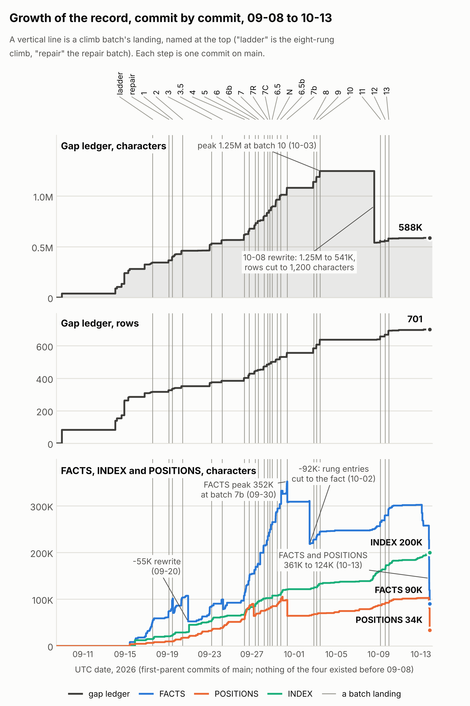

<!-- The Fortress revival from 2026-08-19 to 2026-10-12 told in plain words: how the revival treats the team's work (custodianship, the history kept and the authorship rebuilt from it, the tag where editing began, test first judged by the team's suites, the specification's changes in the team's own form, the type group's later word and the library's practice), the exploring era, the unsealed tree and the climb batches with their decisions and the checker's errors, how the record grew, the skills and the process work, climb batches 11 to 13b, the process study's close and the coordinator rewrite, what changed in Fortress for a programmer, and, for each of the skill's language points, whether the revival left the team's Fortress as it was or resolved a contradiction, and where it changed the team's own text and why. First written 2026-10-08 for the curator. Updated 2026-10-12 by an Opus worker for the curator and for Prof. Sukyoung Ryu: brought through climb batch 13b and the coordinator rewrite, its stale points corrected against the record and git, and a first part added on how the revival treats the team's work. Read-only, from the record and git; the same text is the curator's page "Fortress Revival So Far". -->

# The revival so far, in plain words

Written 2026-10-08, updated 2026-10-12, for the curator. Dates without a year are 2026, times UTC. Each part ends with its sources.

Words used throughout:

- **team**: Designers of Fortress at Sun Labs, later Oracle Labs. Their last commit is `a874948ac` (2012-08-31).
- **type group**: Part of the team that designed the type system and built the compiled type checker.
- **curator**: Person who runs the revival. He sets its goals and decides the design questions put to him.
- **walk**: Interpreter. It runs a program with no static types.
- **compiled path**: Path that compiles a program to JVM bytecode and runs it: `fortress compile`, then `fortress run`.
- **checker**: Static type checker. It runs on the compiled path only.
- **library**: Fortress code that every program loads. There were two. The interpreter's is **the one library**. The compiler's own smaller one is **the prelude**.
- **switch-over**: Point at which the compiled path moves onto the one library and the prelude is deleted. It comes when the checker accepts the one library.
- **record**: Files under `explorations/` that hold what the revival has established (`FACTS.md`), what the curator decided (`POSITIONS.md`) and the plan (`PLAN.md`).
- **gap ledger**: File with one numbered row for each known gap or defect.

## 1. How the revival treats the team's work

**Why now.** The team's work stopped in 2012, when Oracle Labs concluded the project. Its last commit is Karl Naden's write-up on instantiating generics at run time, on 2012-08-31. The curator took the work up in 2026. His reason, in his words: "we're trying to finish what they didn't get time and resources to do". He sees it as possible now, with frontier agentic coding systems. The project is his hobby, done with Claude in his spare time: "a personal learning exercise equal parts about Fortress as a language and agentic coding". Its main goal is a working compiler, so that one program, microGPT, a small GPT model written in Fortress, runs compiled.

### Custodians, not authors

The first principle of the protocol the work follows reads: "We are custodians of their language, not its authors." It asks the revival to finish what the designers intended, judged by the specification and by the library's own practice. Every agent is bound by the same rules through the skill it loads.

- No committed file claims credit for the revival.
- Where git doesn't record who wrote something, the authorship is rebuilt from the history. It's never guessed.
- Reasons go into commit messages and reports, not into the team's source comments.
- Every claim is checked against a primary source: the code, the specification, the papers or a command's output.

### The history, kept whole

- The repository keeps the team's surviving history: 5.4K commits on the trunk, from 2007-01-04 to 2012-08-31. With the old repository's twelve other branches, it's about 5.6K.
- It's a 2018 fork of a git conversion of the project's java.net Mercurial repository. The conversion cut 146 links between commits, so `git blame` here credits whole files to snapshots of 2011 and 2012. Authorship is counted over the full history instead.
- From that history, a map of who wrote what was rebuilt, with the evidence for each identity. The README sums it up: Sukyoung Ryu on the front end, from the parser to the type checker; David Chase on the compiler and the run time; Jan-Willem Maessen on the library; Christine Flood on transactions and the work-stealing run time; and a wider circle of students, interns and visitors.
- The map also says what git can't show. The project began in 2003, four years before the record starts. So Eric Allen, a co-principal investigator from the start, shows only about 230 commits. Two co-authors of the 1.0 specification, Sam Tobin-Hochstadt and Joe Hallett, show none.
- The team's frozen copy of the specification, which Guy Steele made on 2012-01-04, is untouched. It's the Working Draft as of 2011-02-02.

### Where the editing began

- The tag `sealed-tree` marks the territory map's last commit, of 09-16. After it, the revival edits the team's language, library and specification. The tag's message states the rule: each edit starts "from a failing test added to the corpus, with the full suite kept green".
- Before the tag, 28 commits touched the team's code, library or specification. 21 of them only moved the tree onto current Java and Scala: the build, its tools, and the JDK's own fork/join pool in place of the old copy. The other 7 correct the constant e, fix a name clash between the two libraries' `System` apis, speed up the suites and fix the specification's rendering.
- Also before the tag, five surveys mapped the system, down to where the designers wrote their reasons (part 2).

### Test first, judged by the team's suites

- Every edit of the team's code starts from a failing test in the team's suites. The fix follows, and the test stays.
- The check is the suites' own verdict, pass or fail, as the team designed them. A value that matters is asserted inside the test, with the suite's own means: an `assert` in an interpreter test, a `run_out_equals` key in a compiled one. No expected-output file is added. The interpreter's suite never compared one.
- A defect that's measured and not yet fixed gets an expected-failure test, named `XXX…` by the team's own convention for a test that must fail. The team left 56 in the interpreter's suite. There are 120 now.
- Every landing now runs the team's two suites and the specification's 130 extracted examples, with no failure. None of the team's tests or demos has been deleted. 43 of them were edited, each for a reason on record (part 9).

### Changing the team's text

- The team's own sources disagree in places: the specification, the interpreter, the compiler and the type papers. The revival reconciles them. Where the type group's later work departs from the original specification, the revival follows that work: the exclusion rule, built into the checker in 2010, and the OOPSLA 2011 paper on type checking multiple dispatch. After the project came the POPL 2019 paper of Park, Hong, Steele and Ryu. The specification is then updated to match what the revival implements.
- Each change to the specification follows the team's own ways of marking a revision. A labelled callout sits at the changed passage, as the team's 2009 draft put its decisions in notes at the passage. An entry in the changes appendix, Appendix I, lists it, as the 1.0 release listed its changes in an appendix. Each entry quotes the original sentences with their file and line, gives the reason, and says what the alternative not taken would need: the relaxed rule of the team's 2012 patent applications. There are 39.
- The library's own practice is the standard. A fix extends the library the way the library already does the same kind of thing. No fix is designed from a reading of the specification alone.
- The POPL 2019 paper is read at the source. Since 10-10 it's in the repository beside its extract, as its open license allows. Gyunghee Park's talk on it is transcribed from the ACM video. The paper and the talk hold 24 worked examples. The 15 that Fortress can write today were written as programs, run on both paths, and sorted by what each can test. The other 9 need features not built, such as declared covariance.

Sources: `explorations/protocol.md` (principle 1); `.claude/skills/fortress-repo/SKILL.md` ("Rules for every task"); `README.md` ("History", "Lineage and license"); `research/authorship.md` (the caveats, the identity key, who wrote what); `explorations/coordinator/lineage.md`; `git cat-file -p sealed-tree`; `git rev-list --count a874948ac`; `git show c02fa44d0`; `explorations/coordinator/process-engineering/fortress-changes-chronology.md` A0, A1, A10; `explorations/coordinator/POSITIONS.md` ("Test first, the test kept.", "The suite's verdict is the check.", "The S1 form", "The type group's late positions outweigh the early text.", "The library's own practice is the standard."); `explorations/coordinator/FACTS.md` ("The team's latest word on types and on the exclusion rule is the unfinished restart, not `Specification/`"); `explorations/reviews/spec-change-form.md` section 5; `explorations/reviews/popl2019-examples.md`; `research/extracts/ParkPOPL2019-talk.md`; `explorations/compile-ladder/climb-batch-13b/gate/summary.txt`; `Specification/appendices/changes.tex`; the curator's message of 10-12.

## 2. The start and the exploring era (08-19 to 09-16)

### The 2012 tree builds and runs again

- 08-18 and 08-19: the tree built on JDK 8, and the team's tests ran: about 1.4K in `testFast`, 382 in `testSystem`.
- 08-19: the first toy programs ran under walk: a small demo, a Mandelbrot set ported from Swift and rewritten in plain Fortress style, and a ring of complex numbers.
- To 08-21: the build moved to current Java and Scala. These 21 commits change nothing a Fortress programmer sees. The suites ran in parallel, 13 minutes down to 7.5.

**The microGPT rounds (08-23 to 08-30).** microGPT is Karpathy's small GPT in Python. Each round wrote it in Fortress and ran it under walk. A golden check compared its numbers with the Python program's.

- Round 1 (08-23): a direct port. A training step took 10.9 s, against 22 ms in Python.
- 08-24 to 08-30: rewrites in plain Fortress style and in a paper's mathematical style, then a second iteration. The session began to use worker agents.

**Other assistants (09-07 to 09-11).** Astra, another company's coding assistant, wrote its own port outside this session, with no transcript. Later Astra and a second assistant, Sol, joined a discussion of notation.

### Blinded and informed runs (09-08 to 09-15)

- The blinded run (09-08): a fresh session that could not read the earlier ports. It worked alone for 1.5 hours and wrote 15 gap rows.
- Run B (09-09) could read the earlier work: 25 gap rows. Run B2, the coordinating session's own attempt: 39 rows.
- Runs C to C4 (09-14) used a "flat" layout, after Hsu's data design for array languages. C4 merged C2 and C3: a 71-line model passing 40 of 40 checks.
- The APL side quest (to 09-15): APL notation turned into Fortress code by a grammar extension, then microGPT written in it. The curator closed the quest there.

**The ledger's first 309 rows.** Each run wrote a gap table. A merge worker re-ran every reproducer, numbered the rows and folded repeats: 83 rows on 09-08, 139 after Runs B and B2, 265 after the APL merge, rows 288 to 310 on 09-16. `FACTS.md` and `POSITIONS.md` began on 09-15.

**The territory map (09-16).** Before the revival edited the team's language, five surveys described the system: modules, what of the specification is built, tests, dormant code, and the designers' reasons. Two of its facts: the interpreter's tests and the compiler's tests share no program; `Specification-1.0-frozen/` is the team's Working Draft as of 2011-02-02, and `Specification/` is the text the revival revises. The map's last commit was tagged `sealed-tree` (part 1).

Sources: `explorations/process-records/01-microgpt-port.md` to `14-apl-rung-4b.md`; `explorations/microgpt-run-c-handover.md`; `explorations/microgpt-run-c-handover-history.md`; `explorations/coordinator/map/README.md`; `explorations/coordinator/process-engineering/gap-ledger-archaeology.md` section 1.1; `explorations/coordinator/process-engineering/fortress-changes-chronology.md` A0, A1, A10; `explorations/notation-collaboration/README.md`.

## 3. The unsealed tree and batches 1 to 10 (09-17 to 10-03)

**How a batch works.** A batch is one run of a workflow script.

- A **rung** is one piece of work, done by a worker in its own checkout of the tree.
- A **skeptic** checks each rung. Up to batch 10, if it refused, a **judge** ruled, a **repair** agent fixed, and a second skeptic checked. Since batch 11 the skeptic fixes what it finds, and a judge rules only on a fix that's contested.
- The **gather** folds each rung's notes into the record. A **merged-diff review** reads the combined change.
- The **gate** is the full check before landing: the build, both suites, compiled `atomic` programs at four threads, the ladder (below), and the checker's error counts. To **land** is to commit to `main` and push.
- After each batch, one reviewer checks it against the decisions and the designers' intent.

**The first climbs (09-17 to 09-20).** The ladder is 410 of the team's test programs pushed through the compiled path. On the sealed tree 59 passed.

- The ladder climb (09-17): eight rungs added names to the prelude and compiled a top-level `var`. 81 passed. A review found one rung against the specification and one departing from it without a reason.
- The repair batch (09-18 to 09-19) fixed those two.
- Batches 1 and 2 (09-19, 09-20) added more prelude names: `RR64`'s functions, `Maybe`, `GCD`, shifts, integer conversions. 85 passed, and 85 still pass.

**Batches 3 to 10 (09-22 to 10-03).** From 09-21 every batch worked to make the checker accept the one library: 16 landings in 12 days. Names such as 3.5, 6b, 7R, N or 7b are batches split from or added to a plan. Batches 8 to 10 repaired checker defects and the library's one-off slips. The decisions below say which batch built each one.

### The main decisions, in plain words

- **The goal** (09-16). Finish what the designers intended, judged by the specification as revised. The measure is microGPT compiled and running fast. The tree was unsealed on 09-17.
- **Test first** (09-17). Every edit starts from a failing test that stays in the suite (part 1).
- **One library** (09-21). The interpreter's library becomes the only one. The prelude gets no new declaration and goes at the switch-over. The rungs that added prelude names stopped, and the checker's errors on the one library became the measure.
- **The flat number tower** (09-24). The checker keeps the team's rule that no type extends two instantiations of one generic trait. The one library's nested number types broke it, so they became siblings that convert by declared coercions, as in the prelude. Walk learned coercion in batch 4; the library was flattened in batch 6. The checker's errors fell from 125 to 62.
- **Sizes at run time** (09-24). A size parameter (`nat`) gets the run-time descriptor a type argument has. Since batch 5, a sized program compiles and runs.
- **Overflow** (09-26). Fixed-width overflow raises `IntegerOverflow` under walk too. Code meant to wrap uses the specification's operators ∔ ∸ ⨰. Batches 5 and 6b.
- **The plan** (09-26). Six phases: 1 and 2, decided work and the flattening; 3, the checker at zero errors; 4, the switch-over; 5, microGPT compiles; 6, microGPT fast. Phases 1 and 2 are done. Phase 3 has landed through batch 13b (part 6). Phases 4 to 6 haven't started.
- **Ranges over `ZZ32` only**, because a JVM array index is a 32-bit integer. Batch 7R.
- **The inference rule.** When a generic call mixes number types, the type parameter takes the narrowest type all arguments convert into. A parameter that nothing in a call fixes is inferred at its bound, not at the empty type `Bottom`, on both paths, with a few cases left under walk. Batches N, 8, 9 and 11. The rule at run time is only partly built (part 9).
- **The overloading model.** Overloads may differ in static parameters. The return-type rule is checked for every instance. Walk chooses by declared types, not by order in the file. Batch 7b.
- **`fill` takes a value, `tabulate` a function.** Batch 7.
- **Arrays become unboxed `double[]`** (09-19). Decided, not built.
- **Each change to the specification** gets a callout at the passage and an Appendix I entry with the original text and the reason.

**The checker's errors falling.** Two numbers measure the way to the switch-over.

- **The checker count**: the errors the checker reports on the one library. The checker stops at the first error of some checks, so the count misses errors behind the stop. A gate stage from batch 3.
- **The distance to the switch-over**: every error over all the library's files, with no early stop. First measured before batch 7.
- Neither makes the gate red. A fix can raise both, when it lets the checker reach code it couldn't reach before.

**The checker count, where it moved**

- before batch 3: 93
- after 3: 103
- after 4: 125 (a fixed crash showed 22 hidden errors)
- after 6: 62 (the flat number tower)
- after 7: 22
- after 7R: 10
- after 7C: 75 (the checker now reads a clause it used to stop at)
- after 7b: 59
- after 8: 56
- after 9 to 12: 1 (a pair of declarations in `LexicographicReduction`, left for the curator's choice)
- after 13, 13b: 1 (the pair fixed; now the first error in the library's component, part 6)

**The distance to the switch-over, where it moved**

- before batch 7: 1.7K (first measured)
- after 7: 940
- after 7R: 627
- after 7b: 598
- after 8: 565
- after 9: 340
- after 10: 253
- after 11: 207
- after 12: 153
- after 13: 105
- after 13b: 85 (what is left: part 6)

**Where the tokens went.** "Written" means tokens processed fresh: cache writes and new input, the measure the curator uses.

- The 15 batches from the repair batch to 6.5b used 269 agents and wrote 146M tokens.
- Rung workers took about half; skeptics, judges, repairs and reviews about two-fifths.
- 45% of all writes came after an agent waited five minutes or more. The prompt cache lives five minutes, so the agent wrote its whole context again.
- The largest batches: 7 (22M), N (18M), 6.5b (17M). After the post-mortem: 7b 7.3M, 8 and 9 14.6M together, 10 6.3M.

### Where the records went: the post-mortem of 09-29

- Batch 6.5b changed about 280 lines of Fortress code, 90 of specification and 710 of tests. Beside them it committed 866 record files, 46K lines, most of them scratch.
- Nobody had asked the curator whether scratch goes to `main`. It came from six small steps. On 09-19 he asked whether logs were needed. Gate logs stayed out, but rung outputs were then named `.txt`, so `.gitignore` missed them, and he was not told.
- Two cleanings removed 4.4K files (11.7 MB) on 09-29 and 9.9K files (173 MB) on 09-30.
- The new practice: commit only what `main` is to hold; write the test and see it fail first; build or run nothing twice. Batch 7b committed 20 record files.

Sources: `explorations/microgpt-run-c-handover.md` and `explorations/microgpt-run-c-handover-history.md` (the landing paragraphs); `explorations/coordinator/PLAN.md` ("Where we stand", "The phases"); `explorations/coordinator/POSITIONS.md`; `explorations/coordinator/postmortem-2026-09-29/README.md` and `characterization.md`; `explorations/reviews/batch-6.5-review.md` to `batch-13-review.md` (first sections); `explorations/compile-ladder/climb-batch-13b/RECORD.md`; `explorations/compile-ladder/CLIMB.md`; `explorations/coordinator/process-engineering/README.md`.

## 4. How the record grew

The chart has three panels on one time axis. A vertical line marks each batch's landing. Top: the ledger's characters. Middle: its rows. Bottom: FACTS, POSITIONS and INDEX (INDEX has one line for each note under `explorations/`). The figures below are at the chart's end, late on 10-09, just after batch 13 landed.

- The ledger reached `main` on 09-09 with 83 rows. It reached 638 rows and 1.25M characters at batch 10 (10-03). At batch 13 it had 694 rows and 581K characters.
- The exploring era wrote 309 rows, 0.8K characters each on average. At batch 13 they held 247K characters.
- The batches wrote 329 rows to batch 10. At entry they were two to three times as long: 2.6K on average in the first batches, 1.4K in batches 8 to 10. Later edits made them 40% to 55% longer, to 0.88M characters on 10-03. At batch 13 they held 275K. The 56 rows added since batch 10 hold 49K, 0.9K each on average.
- So most of the ledger's text still comes from the batches' rows, not from the exploring era's: 275K against 247K.
- Rows almost never shrank until 10-08: after entry they gained 308K characters and lost 0.8K. Then the ledger was rewritten. Each row was cut to 1,200 characters at most, and the ledger fell from 1.25M to 541K characters in one commit. The mean row went from 1.9K to 0.8K. The earlier text is in a history file, 1.33M characters. Closing a row cuts it too.
- From 09-17 to batch 13, batch runs took 28% of the clock (35% to batch 10; no batch ran from 10-03 to 10-08). They brought 89% of the ledger's new characters and 93% of its new rows (88% and 92% to batch 10).
- FACTS peaked at 352K at batch 7b (09-30). On 10-02 it lost 92K in one commit, when the rung entries were cut to the fact. It was 294K at batch 13.
- POSITIONS peaked at 105K (09-29) and was 94K at batch 13. INDEX never lost more than 324 characters in a commit, and stands at 175K.
- Since the rewrite the ledger grows about 19K characters a batch, against 46K before. FACTS grows back about 15K a batch. `PLAN.md`, where items for the curator collect, never got the new form: it was 464K characters and grew 17K to 53K a batch (part 7).

Sources: `explorations/coordinator/process-engineering/record-growth/README.md`, `per-batch.csv`, `series.csv`, `landings.csv`; `explorations/coordinator/process-engineering/gap-ledger-archaeology.md` sections 1.1 and 2.4; `explorations/fortress-gap-ledger-history.md`; `explorations/coordinator/process-engineering/measures-judgement.md` section 1.

## 5. 10-04 to 10-08: the skills and the process

**The process-engineering study** (opened 10-03) asks whether the weekly token pool is spent well.

- Sharing one build between checkouts had been called impossible for two weeks. Given the goal, fresh agents found the way in about 15 minutes. The waste was 245 of 425 builds, about 7.3 agent-hours.
- One probe wrote 7.0M tokens against an estimate of 0.5M. Now the coordinator watches a long run against its estimate.
- Six designs for running batch 10 were priced: four at 4.5M to 7.5M, two with no cost limit at about 31M and 37M. The study's close found nothing that more agents would fix (part 7).
- On 10-08 the batch workflow was redesigned. The skeptic fixes what it finds, a judge rules only on a contested fix, and there's no second skeptic. Briefs shrank to a third to a ninth of their old size.

**The `fortress-repo` skill**: the instructions every agent loads to work here.

- 10-04: three project skills written from the record and reviewed.
- 10-05: a reader given only the skill found about 30 passages a new reader could not act on.
- 10-05 and 10-06: the curator reviewed it, about 35 comments, grouped as eight lenses. A writer applied them, and every file got shorter.
- 10-07: the skill gained two modes of work, building and exploring.
- 10-08: a fresh session answered a quiz on Fortress from pre-training alone; an audit graded 56 claims correct, 7 wrong, 3 outdated. The section "Fortress as a language" came from it.
- 10-08: the rewritten skill landed between 22:54 and 23:36, six minutes before batch 11 began.

**The context study** (10-08): what batch 10's four rung workers read before their first fix.

- Of what they read: the briefing 25%; code, library, specification and tests 48%; their own searches of the record 4%.
- Relearning what the record held was common but small: about 1% of what they read.
- A "librarian" pass after each batch would cost 0.7M to 0.9M tokens. It pays if it turns the causes of refusals into skill rules.

### The ledger

- An archaeology (10-08) proposed a form. The curator decided: one status word of seven, a class with its area, at most 1.2K characters a row, topic sections with every number kept, the old text in a history file, one tool, `ledger.py`, to write it.
- The ledger check (10-08) compared about 490 rows with the batch records and found three mismatches.
- The rewrite landed on 10-08 at 14:06. The 638 rows kept their numbers and stand in fifteen topic sections (part 4).

**The climb** paused from 10-03 to 10-08 while this work ran. Batch 11 began at 23:42 on 10-08.

Sources: `explorations/coordinator/process-engineering/README.md`, `batch-redesign.md`, `context-study.md`, `ledger-check.md`, `gap-ledger-archaeology.md`, `skill-effect.md` section 1; `explorations/coordinator/INDEX.md`; `explorations/coordinator/POSITIONS.md` (the ledger's form, the skills); `explorations/coordinator/process-engineering/record-growth/README.md`.

## 6. Batches 11 to 13b (10-08 to 10-10)

**What they were for.** Phase 3 went on: make the checker accept the one library, so that the compiled path can move onto it. Batches 11, 12 and 13 landed on 10-09. Batch 13b landed on 10-10, outside a batch, at the curator's word. Each batch built on the curator's answers to the questions its record put, or on the default on record where he hadn't answered yet.

### What changed

- **Batch 11** was the first run of the redesigned workflow, on the rewritten skill. Walk leaves open a type parameter whose bound names itself, so `SUM[i <- 1#100] i` runs again under walk without its element type written. Under walk, a trait's `override` now overrides for every type below it. The checker reads what a type provides as the traits chapter says, by which the team's own test `disp0.fss` is valid. The ranges of rank 2 and 3 got types for their bounded ranges.
- **Batch 12.** Walk now refuses at load what the traits chapter makes a static error: an object that leaves an inherited abstract method without a body, and an `override` that overrides nothing. A range of rank 2 or 3 is checked against an array's bounds corner by corner, so a corner outside them raises `IndexOutOfBounds`. Reductions without an identity, such as `BIG MAX`, are typed at their element type.
- **Batch 13.** The checker accepts arithmetic in a size, and a size known only at run time. For the second it restores a `comprises` clause the team had left as a comment on `NatParam`. Pairs and triples compare only elements that have an order, an answer to the team's own comment on them: "Shouldn't these operators have to extend something?" A generator has a size by default, counted by running it.
- **Batch 13b.** Batch 13 built a bound for the array family, `T extends { Number, MultiplicativeRing[\T\] }`, and held it back. Under it the checker took 17 minutes on the library's api, past the stage's limit of 15. A prototype found the cause: the checker expanded `Number`'s `comprises` clause again at every subtype question. A memo of the answers that don't depend on context cut the count's stage from 24 minutes to 6 and the distance's from 76 to 31, with every answer the same. The fix and the held bound landed together.

### What they moved

- The distance fell from 253 to 207, 153, 105 and, with 13b, 85.
- The checker count stayed at 1, and the error behind it changed. Through batch 12 it was a pair of declarations in the library's api. Batch 13 fixed the pair, and the api now checks clean. So the checker goes on to the library's component, and its first error there stops it: `__bigOperator`'s local function `body(i)` has no type on its parameter. Once that's typed, the count will show the component's own errors, 79 by the distance, before it falls.
- Every gate was green at its first run. At 13b the suites ran 1.9K and 580 tests and the specification's 130 examples with no failure, and 42 compiled `atomic` runs passed at four threads.
- microGPT still runs under walk, and its quick check passes at each landing. On the compiled path the 18 files of its two versions all stop at name resolution, as expected before the switch-over.

### The new workflow, measured

- Batches 11, 12 and 13 wrote 5.0M, 5.4M and 7.2M tokens. Batches 8 to 10 wrote 7.7M, 6.9M and 6.3M. The mean fell 15%.
- The saving is the second round's removal. Refusal cycles took 20% to 28% of a batch before, and 3% to 6% after.
- Batch 13 cost the most. A VM restart stopped two skeptics, one rung timed the slow checker twice, and a third ruling was needed.
- Quality held, as far as the reviews can tell. Every rung was judged in the spirit of the decisions. No wrong value landed, and no review found a blocking defect. The skeptics made 57 fixes, all sound and test first. The six rulings were all upheld.

### What is left

- Of the 85, 29 are bodies over the self-typed `Integral` trait, which wait for a judgement on how to type them. 19 are in the array family. 16 are one-off slips and limits of the checker. The rest are small groups.
- Each batch recorded the new gaps it met on the way and listed items for the curator: 24 in batch 11, 22 in batch 12, 53 in batch 13. Of batch 13's that reached PLAN, all but one carried a default that had already landed, or were for information (part 7).
- No batch 14 runs until the `coordinator` and `cloud-container` skills are rewritten (part 7).

Sources: `explorations/reviews/batch-11-review.md`, `batch-12-review.md`, `batch-13-review.md` (first sections); `explorations/compile-ladder/climb-batch-11/RECORD.md` to `climb-batch-13b/RECORD.md`; `explorations/compile-ladder/climb-batch-13b/gate/`; `explorations/perf-probes/checker-speed/REPORT.md`; `explorations/coordinator/PLAN.md` ("Where we stand"; batches 11 to 13 under "The phases"); `explorations/coordinator/FACTS.md` ("The true distance to the switch-over ...", "The distance to the switch-over by root cause ..."); `.claude/skills/fortress-repo/references/revival-changes.md`; `explorations/coordinator/process-engineering/skill-effect.md` section 1; `measures-judgement.md` sections 2.1 and 4.

## 7. Since 10-10: the study's close and the coordinator rewrite

**The process-engineering study closed** on 10-10 with two reports. They ask whether the measures of 10-08 did what each was for.

- The workflow's redesign met its aim. A batch writes 15% fewer tokens and a rung 27% fewer, and nothing measured shows a loss of quality.
- The skill met one aim and missed its price. Agents stopped relearning what it covers: calls that read a script to learn how to run it fell by 70%. But it costs 0.47M to 0.65M tokens a batch, two to three times the estimate.
- The skill's main aim, a correct model of Fortress, hasn't been measured. A quiz with the skill and without it would measure it for about 0.15M.
- The record's new form worked for the ledger, not yet for the rest. FACTS grows back, and PLAN held 202 entries listed for the curator.
- Nothing distils the record for the curator. A batch hands him tens of items. Of the 47 that batch 13 put in PLAN, one needed his word. The rest carried a landed default or were for information. The first step proposed is one short queue of what needs him.
- The same day the review queue was rewritten: 50 items that need him, 122 routine ones, and 76 already settled.

**The map before the rewrite** (10-10). Before the coordinator's skill is rewritten, a worker mapped the coordinator's records: what they hold, who reads them, and where they repeat.

- A boot, after a compaction or a restart, reads eight things: about 243K tokens of record, about 317K with the session's fixed part. They grew by half in two weeks.
- 73 rules of conduct are stated in 249 places. Only two of them have a single home.
- A fifth to a quarter of FACTS, and about a tenth of POSITIONS, is history rather than what holds now.

**The coordinator rewrite** is under way. Its goals, as the curator corrected them on 10-10:

- One home for how the coordinator works. The protocol retires, and its rules that bind workers move to the workers' skill.
- One home and a stated purpose for every kind of record.
- A lighter boot that keeps what he relies on. The coordinator knows the project without him re-explaining it, never re-asks a decision, and never sends a worker to measure again what's on record.
- No role lost: executive assistant, batch coordinator, roadmap architect, briefer of workers, analyst.
- The skill rests on the model's own habits, not on hundreds of small rules. In his words: "Organization of the knowledge base should reflect the model's second nature, never fight it."

Done so far: an interview of the two current models, Fable and Opus, one question per turn, as their natural baseline. Two sorts of the 73 rules against it. An archaeology of how ten duplicated rules spread. The boot note and the list of held points now have files of their own. A rule is kept when the failure it guards against is on record.

The order from here. FACTS and POSITIONS are rewritten slice by slice, each earlier text kept word for word in a history file, and each slice shown to him on a page. Then an Opus writer writes the coordinator skill from scratch, followed by a cold read and his reading. Then the `cloud-container` skill is rewritten the same way. Batch 14 comes after both.

Sources: `explorations/coordinator/process-engineering/skill-effect.md` sections 1 and 7; `measures-judgement.md` sections 1, 4 and 5; `coordinator-shape.md` sections 1, 2, 4.1 and 5; `explorations/coordinator/POSITIONS.md` ("The coordinator rewrite's goals."); `explorations/coordinator/PLAN.md` ("Where we stand"); `explorations/coordinator/BOOT.md`; `explorations/coordinator/review-queue.md` (commit `2b9c45165`); `explorations/coordinator/process-engineering/rule-sort.md`, `rule-sort-b.md`, `duplicated-rules-evidence.md`.

## 8. What the revival changed in Fortress itself

Changes a programmer writing Fortress would notice, by area. Part 9 gives the reason for each.

### Numbers

- The number types are siblings under `Number`, not a tower, as the team's prelude already had them. A wider type converts from a narrower one by a declared `coerce`.
- Fixed-width overflow raises `IntegerOverflow` under walk, as on the compiled path. To wrap on purpose, write ∔, ∸ or ⨰.
- `SUM` and `PROD` are generic. Under walk, a reduction whose element type nothing fixes runs. The checker still needs it written: `SUM[\ZZ32\][j <- 0#i] f(j)`.
- `QQ` is exact. A negative shift count shifts the other way. `GCD` and `LCM` are never negative. `narrow` keeps the low 32 bits. `round` sends an exact half to the even integer.
- `QQ`'s `floor`, `ceiling`, `round` and `truncate` throw `DivisionByZero` at +∞, −∞ and 0/0.
- The library's numeral type is `IntLiteral`, a sibling that the integer types, `QQ` and `RR64` convert from. Walk's numerals are unchanged for now.

### Ranges

- Ranges are over `ZZ32` only. A range over `ZZ64`, `NN32`, `NN64` or `ZZ` stops when built.
- Ranges of rank 2 and 3 have bounded types of their own, `BoundedRange2D` and `BoundedRange3D`. `#(0,n)` is empty.
- An array subscript of rank 2 or 3 is checked corner by corner, so a corner outside the bounds raises `IndexOutOfBounds`.
- The open range `(:)` can't be cut: its `truncL`, `truncR`, `every`, `imposeStride` and `atMost` fail.

### Arrays and the rest of the library

- `fill` takes a value; `tabulate` takes a function.
- The array types bound their elements: `T extends { Number, MultiplicativeRing[\T\] }`.
- `String`'s `left` and `right` answer `Just` of a character, or `Nothing`. `String`'s juxtaposition is three top-level operators.
- Pairs and triples compare only elements that have an order. Under walk, `(1,2) < (1,2.5)` is refused.
- A reduction without an identity lifts to `Maybe[\R\]`.
- Every generator has a size. The default counts its elements.
- Array storage is still boxed.

### Walk

- Walk converts by coercion at calls, bindings and assignments, picking the coercion from the run-time value.
- Walk infers type arguments through coercions. A type parameter nothing fixes takes its bound, and one whose bound names itself stays open.
- Walk chooses between a generic and a plain declaration by declared types, not by order in the file.
- A trait's `override` overrides for every type below it.
- At load, walk refuses some programs it used to run: an object extending two closed traits without being listed; two functional methods with no declaration on their meet, in generic types and object expressions too; an object that leaves an inherited abstract method without a body; an `override` that overrides nothing.
- Five of the team's demos leave an inherited abstract method without a body, so walk now refuses them. Two of them, `BirdCount1z` and `BirdCount2a`, ran before.

### The checker

- It checks `nat` and `int` size parameters, arithmetic in a size, and a size known only at run time.
- It infers static arguments through coercions. A type parameter nothing fixes is inferred at its bounds, never at `Bottom`.
- Overloads may differ in static parameters. The return-type rule is checked for every instance.
- It judges two functional methods for each type that provides both, and reads what a type provides as the traits chapter says.
- It refuses a parameter written without a type, with "Missing parameter type for".
- It gives a call its expected type in more places: an `if` without `else`, a `typecase` branch, a `label`'s body, an operator repeated between operands, a tight juxtaposition.
- It remembers the subtype answers that don't depend on context, so it no longer expands `Number`'s `comprises` clause again at every subtype question.

### The code generator and the run time

- A top-level `var` compiles, and `atomic` covers it.
- A numeral of exactly 32 or 64 bits keeps its value.
- A sized program compiles, loads and runs. A size computed in a type names one class: `Box[\2 + 1\]` and `Box[\3\]` are the same.
- Generic code dispatches correctly on four threads.
- An object with no `asString` prints its type name.

**The specification.** Appendix I has 39 entries, each with the original text and the reason.

### Size of the internal changes

- 143 commits touched the code, library or specification: 28 before the tag, 21 of them toolchain; 115 after it.
- Lines added after the tag: walk 3.3K, checker 1.8K, code generator and run time 1.0K, specification 5.3K, tests 14.5K. The library gained 3.6K lines and lost 2.3K.
- The grammar is unchanged. The syntax tree gained one node. 43 of the team's test and demo files changed, and none was deleted. The suites grew from about 1.4K and 382 tests to 1.9K and 580.

Sources: `.claude/skills/fortress-repo/references/revival-changes.md`; `explorations/coordinator/process-engineering/fortress-changes-chronology.md` part A (to batch 10); `explorations/coordinator/PLAN.md` (batches 11 to 13 and 13b under "The phases"; the team's demos under its section of answers); `explorations/compile-ladder/climb-batch-13b/RECORD.md` and `gate/summary.txt`; `git rev-list --count` and `git diff --numstat 75cca6683 main` over the same paths and areas as the chronology, which this method reproduces at batch 10; `git diff --diff-filter=M` and `=D a874948ac main` over `tests/`, `library_tests/`, `demos/` and `compiler_tests/`.

## 9. The original Fortress and the revival's resolutions

The skill every agent loads has a section, "Fortress as a language". Each of its points corrects a belief an agent may bring from its training. A part of the skill lists, under the same points, each place where the revival changed the team's Fortress, with the original, the resolution and the reason. This part tells it in plain words.

### The team left three sources that disagree

The team left Fortress in three forms, with the type papers beside them:

- the specification, the text that says what Fortress is;
- the interpreter (walk) and its library;
- the compiler and its own, smaller library.

These disagree in places. The revival changes the team's Fortress for one of two reasons only: two of these sources contradict each other, or a program fails. It reconciles them. Where the team's later work, in the compiler's library or the type papers, departs from the original specification, the revival follows the later work. It then updates the specification to match what it implements. A callout marks the passage, and Appendix I keeps the original text with the reason.

### Example: the number types

- The team's interpreter library put the number types in a tower. A narrower type was a kind of the wider type: `ZZ32` was a kind of `ZZ64`, and `ZZ64` a kind of `ZZ`.
- The prelude went from siblings to a tower and back in 2009. Christine Flood declared its widths as sibling objects in March. Jan-Willem Maessen made them a tower later that month. David Chase cut the subtyping between the widths in August. Sukyoung Ryu added the first exclusion, `ZZ32 excludes ZZ64`, in October. Maessen and Eric Allen widened the exclusions and added the first coercions, from November 2009 to January 2010. Guy Steele built the comparisons and the integer operators on the flat prelude in 2011.
- In 2010 Justin Hilburn built the exclusion rule into the checker: no type may extend two instantiations of one generic trait. In the tower, `ZZ32` is both an `Integral` of `ZZ32` and, through `ZZ64`, an `Integral` of `ZZ64`, which the rule refuses. The siblings obey it.
- On 09-24 the curator chose to keep the rule. Batch 6 made the interpreter's library siblings too, on 09-27, so that the checker accepts it.

So a model that remembers the tower remembers the team's interpreter library correctly. What it doesn't know is that the team's compiler had left the tower in 2009.

### Left as the team had it

- Functional methods: a method with `self` among its parameters is called as `f(x)`.
- Juxtaposition as an operator, and the whitespace rules. The grammar is unchanged.
- Declarations: `x = e`, `var x: T = e`, `x := e`.
- Loops and reductions are library code. A `for` loop, a comprehension and `SUM` turn into calls to library objects: a generator, which produces the values, and a reduction, which combines them.
- Evaluation is parallel by default. The revival pins the suites to four threads in the build file, so every run is parallel and alike on any machine.
- Only the compiled path checks static types. Walk checks more when it loads a program, but these aren't static types.
- What the specification describes and the team never built is still unbuilt: dimensions and units, `property` declarations, regions, reduction variables, complex numbers.

### Where the revival resolved a contradiction

Each item gives what the team left, then the resolution and its reason.

#### Dispatch on every argument

- **Overloads that differ in static parameters.**
  - Original: the Working Draft says, in its overloading chapter:

    > Although there may be multiple declarations with the same functional name, it is an error for their static parameters to differ (up to α-equivalence), or for one declaration to have static parameters and another to not have them. Hence, static parameters do not enter into the determination of which declarations are applicable, so we ignore them for most of this chapter.

    The 1.0 release of March 2008 doesn't have this sentence: it compared such declarations by taking their type parameters' bounds as supertypes. In git, the sentence first appears in the specification's sources as Sukyoung Ryu re-imported them in November 2009. Neither implementation enforced it. The checker implements the type group's model of 2011, from the OOPSLA paper of Allen, Hilburn, Kilpatrick, Luchangco, Ryu, Chase and Steele, which allows such overloads. The team's unfinished 2012 restart of the specification leaves the sentence out.

  - Resolution: such overloads are allowed, and the specification states the 2011 model. Appendix I quotes the old sentence. The reason: the implementations and the library already overload across static parameters, and enforcing the sentence would refuse about 180 pairs of declarations in the library's apis.
- **The return-type rule.**
  - Original: the 2011 paper asks for the rule on every instance of a generic declaration. The checker tested one. A pair that broke the rule then passed the checker and failed the JVM's check of the bytecode.
  - Resolution: the checker tests every instance, as the paper asks. Such a program now fails when it's compiled, not when it runs.
- **How walk chooses between a generic and a plain declaration.**
  - Original: the specification chooses by the declarations' types. Walk chose by their order in the file.
  - Resolution: walk now chooses by the declared types, as the specification says. A program's answer no longer depends on the order of its declarations.
- **`fill` and `tabulate`.**
  - Original: the interpreter's library had two array methods named `fill`, one taking a value and one a function of the index. For elements of type `Any` or of a function type, both apply and neither is more specific. The checker refused the pair, and walk called a function meant as the value.
  - Resolution: the function form is named `tabulate`. Scala's `Array.fill` and `Array.tabulate` have the same two meanings.

#### Traits and objects

- **The exclusion rule.**
  - Original: the checker has enforced the rule since 2010, and the 2011 paper states it. The Working Draft doesn't, and some of its examples break it.
  - Resolution: the specification states the rule. It keeps the examples that break it, marked "Not allowed". The reason: without the rule, the checker's return-type rule lets through programs that die with `IncompatibleClassChangeError`. The team's later texts keep the rule. The Types chapter of the unfinished 2012 restart restates it as "instantiation exclusion". The POPL 2019 paper of Park, Hong, Steele and Ryu keeps it too: a class that extends two instances of a trait extends an instance below both.
- **What a `comprises` clause says.**
  - Original: four passages of the Working Draft read it as a statement about types, and so are false for some programs it allows. The Types chapter of the 2012 restart reads it as a statement about values.
  - Resolution: every value of the closed trait is a value of a listed type. A generic trait may extend the closed trait without being listed, if each type that extends it is below a listed type. Read by values, the passages hold.
- **A trait's `override`, and object expressions, under walk.**
  - Original: walk dropped an inherited declaration only where the object itself declared the `override`. Its load check of the Meet Rule for functional methods skipped object expressions.
  - Resolution: a trait's `override` overrides for every type below it, and walk checks object expressions under the Meet Rule. These are the traits chapter's rule and the Meet Rule's own wording, which names object expressions.
- **An abstract method without a body, and an `override` that overrides nothing.**
  - Original: the traits chapter makes both static errors. Walk loaded both.
  - Resolution: walk refuses them at load. Five of the team's demos leave an abstract method without a body, so walk refuses them now. They're left unedited for the curator's choice.
- **What a type provides.**
  - Original: the traits chapter says a type doesn't inherit a declaration that its own `override` overrides. The checker read every declaration of every supertype as provided, and refused the team's test `disp0.fss`, whose `override` widens a parameter.
  - Resolution: both paths read what a type provides as the chapter says. By it, the team's own test is valid.

#### Static parameters

- **The bound of a type parameter with no written bound.**
  - Original: the Working Draft says `Object`. The library uses its generic containers with tuples, which `Object` doesn't hold, and writes `Any` where it states a bound.
  - Resolution: the bound is `Any`, because the library works only with `Any`. The compiled path keeps `Object` until the switch-over.
- **A type parameter that nothing in a call fixes.**
  - Original: the implementations gave it the empty type `Bottom`, or left it unsolved, and some such compiled calls failed the JVM's check of the bytecode. The POPL 2019 paper gives such a parameter its bound: at run-time dispatch, the intersection of its upper bounds under the call's static return type, never `Bottom`.
  - Built: the specification states the paper's rule. The checker infers such a parameter at its bounds, never at `Bottom`. Walk gives it its declared bound, and leaves open one whose bound names itself, such as `SUM`'s. Walk still gives `Bottom` in four narrow cases, among them a big operator's parameters with a plain bound.
  - Not built yet: at run time both implementations still run a dispatched generic declaration at the value's type where nothing fixes the parameter. Walk can't do otherwise, having no static types. The compiled path waits for phase 5, when its dispatcher will carry the call's static return type. A callout in the specification says so, and expected-failure tests hold the shapes where it matters.
  - Reason: the paper is the latest published word on the rule.
- **Sizes on the compiled path.**
  - Original: the specification has size parameters. The compiled path couldn't carry them, but its code generator had a slot reserved for them.
  - Resolution: the revival fills the reserved slot, in the team's pattern for type arguments. This completes the team's design, and a program with sizes now compiles and runs.
- **Arithmetic in a size.**
  - Original: the Working Draft allows a sum, a difference, a product or a power as a size, but doesn't say when two such sizes are the same. The checker refused any arithmetic in a size.
  - Resolution: two sizes are the same when they're written alike once each operation on numerals is computed, and a size with a static parameter in it isn't known to differ from a numeral. The library needs the first: it writes a product in the storage of its matrices. The team's questions and answers in the appendix "Internal Document" give the second: they refuse two overloads at `T[\n+1\]` and `T[\0\]`.
- **A size known only at run time.**
  - Original: `reflect` answers a `NatParam`. The team's clause `comprises { N[\n\] } where [\ nat n \]` on it was a comment, and the api's comment says that a `NatParam` passed where `N[\n\]` is expected makes `n` a static parameter. The checker refused every such call in the library. Walk ran them.
  - Resolution: the clause is restored, and the checker binds the call's size to the value's own size, as the team's comment says.
- **Comparing pairs and triples.**
  - Original: the interpreter's library compared them lexicographically over element types with no bound, under the team's comment "Shouldn't these operators have to extend something? A,B,C?". Walk answered `true` for `((1,2),3) < ((1,3),0)`.
  - Resolution: each element type extends `StandardPartialOrder`, as the team did for the range points' own comparisons. A pair whose deciding elements are unordered answers `false`, as `RR64`'s comparisons do for a NaN.

#### Numbers

- **Tower or siblings.** The example above. The one library now has the number types as siblings, as the prelude had them, because the checker's rule refuses the tower.
- **Conversion in walk.**
  - Original: the specification says that a call converts its arguments when that makes it apply. Walk had a note "TODO add checks for COERCE" at that place.
  - Resolution: walk now converts the arguments, as the specification says. The revival did the work the team's note left to do.
- **Mixed number types in a generic call.**
  - Original: neither implementation inferred a static argument through a conversion. The tower needed none: a `ZZ32` was a `ZZ64`.
  - Resolution: the parameter takes the narrowest type all the arguments convert into. Among siblings, only a conversion joins two widths.
- **Overflow.**
  - Original: the specification and the compiled path raise `IntegerOverflow` when a fixed-width result doesn't fit. Walk wrapped the result.
  - Resolution: walk now raises `IntegerOverflow`. Code that means to wrap uses the specification's own wrapping operators.
- **Ranges.**
  - Original: the interpreter's ranges took any integer type. The prelude had ranges over `ZZ32` only. The interpreter's library had no bounded range type of rank 2 or 3, and checked such a range against bounds by comparing pairs in dictionary order, so a subarray could read past its bounds.
  - Resolution: ranges are over `ZZ32` only, as in the prelude, since a JVM array index is a 32-bit integer. Ranges of rank 2 and 3 got bounded types and are checked corner by corner, after the design of the rank-1 types.
- **`SUM` and `PROD`.**
  - Original: `SUM` used catch-all operators on `Number`, under the team's comment "Hack to permit any Number to work non-parametrically". Those operators went with the tower.
  - Resolution: `SUM` and `PROD` are one generic declaration each, over the element type's own algebra, which gives the zero or one at that type.
- **Rounding a rational at an infinity or 0/0.**
  - Original: the Working Draft gives `QQ`'s `floor`, `ceiling`, `round` and `truncate` the result type ℤ, and a later paragraph says they return the argument at +∞, −∞ and 0/0.
  - Resolution: they throw `DivisionByZero` there, because the declared result is an integer.

#### Loops and reductions

- **Reductions without an identity.** The interpreter's library lifted them to `AnyMaybe` and joined values at `Any`, while its api declared `lift(r:R)`. They now lift to `Maybe[\R\]`, the type the api and `Set`'s `Intersection` already wrote.
- **A generator's size.** `Generator` declared no size, though three library bodies read one. It now has a default that counts the elements, so "only needs to define the generate method" stays true.

#### Specified, but not built

- **A parameter whose type is left out.** The components chapter says type inference finds every type a component leaves out, but no text describes that inference. The checker refused such a parameter at top level and crashed on a local function's. Now the compiled path refuses every such parameter, and the specification says so. This is the one error the checker count shows now.

### Where the revival changed the team's own text, and why

- **The specification.** 39 entries in Appendix I, each with a callout at the changed passage. Each follows a decision of the revival, most of them the resolutions above. The original sentences are quoted with their file and line, and the team's frozen copy is untouched.
- **The library.** The interpreter's library changed most: 3.3K lines added and 2.3K removed since the tag. Each change is either one a resolution above calls for, or a slip the checker refused. The rule is to make each with the library's own devices, as it already does for the same kind of thing.
- **The team's tests and demos.** 43 of their files changed, and none was deleted. The reasons include: code meant to wrap now writes the wrapping operators (six tests); `SUM` is written with its element type; `fill`'s function form is renamed `tabulate` (seven tests and the demos); numerals and shifts changed in `UnsignedTest` and two others; the ranges changed in `RangePrototype`; a reduction without an identity names its lifted type, `Maybe`, in `HeapTest` and a demo.
- **Left as the team had it.** The grammar, the evaluation model, the algebraic traits, the frozen specification and the full history.

### Where the quiz was right about the original

A fresh model answered a quiz on Fortress from its training alone (part 5). The audit graded each answer against today's tree, so an answer can be right about the team's Fortress and still be graded down:

- The quiz didn't say how the number types relate. A reader who assumes a tower, narrower below wider, describes the team's interpreter library exactly.
- Its answer that overflow raises an error, graded correct, holds for the team's specification and compiler. The team's walk wrapped.

Some answers marked wrong come from the team's own specification, which describes more than the team built:

- `Monoid[\T, ⊕\]` with laws: a chapter of the specification. The library has it only in a comment and in its incomplete folder.
- `fortress run Foo.fss`: the specification's overview says this. The team's tool runs a program under walk with `fortress Foo.fss`.
- Complex numbers: named in the specification, in no library.
- Tests that state their expected output: the team's compiler tests do this. Its interpreter tests don't.

Two answers are wrong for both the team and the revival: integer types that wrap by themselves (the specification wraps only with its own operators), and an `Any` type that doesn't hold tuples. One more is wrong for the team: the guess that walk built part of the coercion rules. The team's walk had none. The revival added them.

Sources: `.claude/skills/fortress-repo/references/revival-changes.md`; `.claude/skills/fortress-repo/SKILL.md` ("Fortress as a language"); `explorations/coordinator/FACTS.md` ("The flattening's three questions, measured by a clean worker", "The team's latest word on types and on the exclusion rule is the unfinished restart, not `Specification/`", "The exclusion fork, priced three ways and dated"); `explorations/coordinator/POSITIONS.md` ("The static-parameter sentence goes (answer 9).", "A type parameter the arguments do not fix takes its bound, never `Bottom` (the paper's instance rule)."); `Specification-1.0-frozen/basic/overloading.tex` lines 100 to 108; `Specification-1.0-frozen/fortress.1.0.pdf` section 15.6.1; `Documentation/Specification/Prose/Language/overloading.tick` lines 100 to 114; `Specification/appendices/changes.tex` ("Overloading with static parameters"); `Papers/Types/paper.tick` lines 213 to 221; `research/extracts/ParkPOPL2019-extract.md`; `explorations/reviews/multiple-instantiation-exclusion.md`; `explorations/reviews/mie-probes/spec-sentences-dated.md`; `explorations/coordinator/process-engineering/fortress-changes-chronology.md` A10, A12 and part B; `git show a874948ac:Library/FortressLibrary.fsi` (the team's `ZZ32` and `ZZ64`); `git diff --numstat 75cca6683 main -- Library ProjectFortress/LibraryBuiltin`, the prelude's files left out; `git show --stat aadd02f23`; `explorations/reviews/fortress-pretraining-quiz.md`; `explorations/reviews/skills-distillation-audit.md` section B; the team's commits, read with `git show -s`:

1. `b2880c05c` (Flood, 2009-03-03), `76c267f98` (Maessen, 2009-03-30), `6896886fb` (Chase, 2009-08-31), `3e0306166` (Ryu, 2009-10-16), `128f313b5` (Maessen, 2009-11-17), `2ef730c88` and `d0cde7d17` (Allen, 2010-01), `b3c2e1342`, `da5291587` and `d535963cb` (Steele, 2011): the prelude's number types;
2. `5a6b7913b` and `e828b44b1` (Hilburn, 2010-05-28 and 2010-07-26): the exclusion rule in the checker;
3. `cec470a34` and `0f49d8698` (Ryu, 2009-11-02 and 2009-11-06): the first commits holding the static-parameter sentence, in the re-import of the specification's sources;
4. `166841592` and `275b90773` (Luchangco, 2012-02-20 and 2012-05-31): the restart begun, and its Types chapter.
